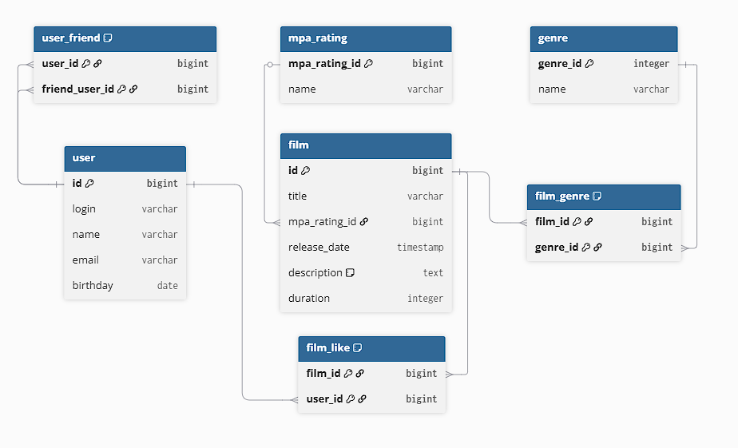

# Filmorate — Бэкенд-сервис для оценки фильмов и рекомендаций

Социальная бэкенд-платформа на базе Spring Boot для рецензирования медиа-контента, ведения списков друзей и формирования рейтингов.

## 🚀 Ключевые архитектурные и технические фичи

*   **Миграция на СУБД (Spring JDBC):** Перевод приложения из оперативной памяти (`In-Memory`) на встроенную реляционную базу данных H2 с помощью `JdbcTemplate` с сохранением обратной совместимости REST API.
*   **Нормализация схемы данных:** Проектирование реляционной структуры со сложными связями (отношения «дружбы») и отношений «многие-ко-многим» (лайки к фильмам, жанры).

## 🛠️ Технологический стек

*   **Язык и фреймворки:** Java 21, Spring Boot 3.x (Spring Web, Spring JDBC).
*   **Базы данных:** H2 Database.
*   **Инструменты:** Maven, Lombok.

## 🏗️ Схема базы данных (ER-Diagram)


## 💻 Локальный запуск

Проект полностью автономен и работает на базе встроенной СУБД H2, поэтому предварительная установка сторонних баз данных не требуется.

1. Клонируйте репозиторий через SSH:
```bash
git clone git@github.com:krvdenis/java-filmorate.git
cd java-filmorate
```

2. Соберите проект и запустите приложение с помощью Maven:
```bash
mvn clean package
java -jar target/*.jar
```

После успешного старта сервис будет доступен по адресу: `http://localhost:8080`

## 📊 Выводы по результатам проекта

* **Успешно выполнен глубокий рефакторинг слоя данных:** Перевод хранения данных со структур In-Memory на встроенную реляционную БД H2 через Spring JDBC реализован с сохранением 100% обратной совместимости API, что гарантирует надежную сохранность информации при перезапуске приложения.
* **Спроектирована оптимальная структура реляционных связей:** Нормализация схемы данных позволила эффективно обрабатывать социальные графы пользователей (отношения дружбы и лайков) стандартными SQL-средствами, избавив бизнес-логику от громоздких манипуляций с коллекциями в Java-коде.
